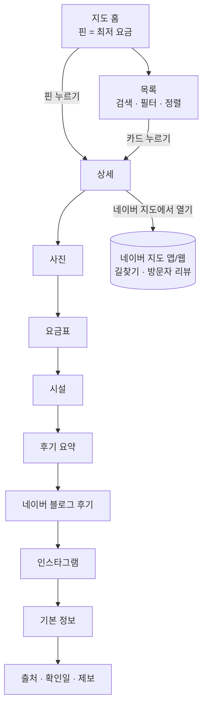
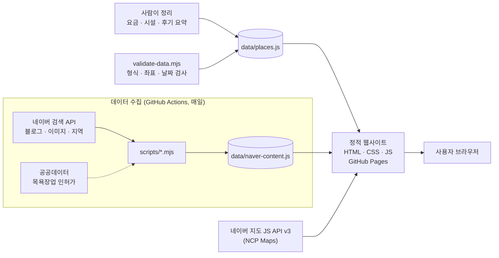

# 서울 찜질방 지도 기획서 v0.1

> 서울 찜질방의 **요금 · 시설 · 후기 · 사진**을 **네이버 지도 위에서 한 번에 비교**하는 웹 서비스
>
> 작성일 2026-11-11 · 상태: 초안 + 동작하는 프로토타입(`jjimjilbang-map/`) 포함

---

## 1. 왜 만드나

찜질방을 고를 때 필요한 정보가 여기저기 흩어져 있어요.

| 문제 | 실제로 겪는 상황 |
| --- | --- |
| 정보가 흩어져 있음 | 요금은 블로그, 시설은 네이버 플레이스 사진, 분위기는 인스타에서 따로 찾아야 함 |
| 요금이 출처마다 다름 | 이번 조사에서도 같은 곳의 성인 요금이 자료마다 13,000원~18,000원으로 달랐음. 대부분 날짜 표시가 없음 |
| 폐업한 곳이 아직 "추천"으로 돌아다님 | 드래곤힐스파(용산, 코로나 이후 영업 중단), 이태원랜드(철거), 실로암불가마사우나(2021 폐업)가 여전히 추천 글에 등장 |
| 시설 비교가 어려움 | "노천탕 있고 여성 수면실 있는 24시간 찜질방"을 찾으려면 한 곳씩 다 열어봐야 함 |

**기회:** 요금과 시설을 같은 기준으로 정리하고, 모든 요금에 출처와 날짜를 붙이고, 후기와 사진은 원문으로 바로 연결하는 지도 하나.

## 2. 목표와 범위

**MVP 목표**

- 서울에서 영업 중인 찜질방 30곳 이상을 네이버 지도에 표시 (지금 17곳, 후보 31곳 확인 중)
- 지도 핀에 최저 요금을 바로 보여줘서 가격을 한눈에 비교
- 요금 · 운영시간 · 시설 · 후기 요약 · 네이버/인스타 후기 링크 · 사진을 상세 화면 하나에 모음
- 모든 요금에 출처와 확인 날짜를 표시

**당장 하지 않을 것**

- 예약·결제, 회원가입, 자체 리뷰 작성: 운영 부담과 법적 책임이 커서 반응을 본 뒤 결정
- 서울 밖 지역: 데이터 품질을 서울에서 먼저 검증

## 3. 누가 쓰나

| 사용자 | 이런 순간에 | 필요한 것 | 대응 기능 |
| --- | --- | --- | --- |
| 데이트·친구 모임 (20대) | 주말에 분위기 좋은 곳을 찾을 때 | 사진, 인스타 감성, 루프탑·노천탕 | 사진 갤러리, 인스타 해시태그, 시설 필터 |
| 막차 놓친 직장인·여행자 | 밤 12시, 근처에서 잘 곳이 필요할 때 | 24시간, 수면실, 야간 요금, 거리 | 24시간 필터, 가까운순, 야간 요금표 |
| 아이 있는 가족 | 주말 나들이 | 키즈존, 주차, 소인 요금 | 키즈존·주차 필터, 소인 요금 행 |
| 외국인 관광객 (확장) | 숙소 대신 찜질방 체험 | 영문명, 위치, 요금 | 영문명 표시 (영어 UI는 2단계) |

## 4. 비슷한 서비스와 차이점

| 서비스 | 잘하는 것 | 아쉬운 점 |
| --- | --- | --- |
| 네이버 지도·플레이스 | 장소 정보, 방문자 리뷰, 사진이 가장 많음 | 찜질방끼리 요금·시설을 나란히 비교할 수 없음. 요금이 사진 속 안내판에만 있는 경우가 많음 |
| 카카오맵 | 위치·길찾기 | 찜질방 리뷰·요금 정보가 적음 |
| 블로그·인스타그램 | 생생한 후기와 사진 | 광고 글이 섞이고 날짜가 제각각, 폐업 여부를 알기 어려움 |
| 입장권 판매 플랫폼 (WAUG 등) | 할인 입장권 | 일부 대형점만 있음, 외국인 대상 |

**우리 서비스의 차이점:** 같은 기준(표준 시설 코드, 같은 형식의 요금표)으로 정리한 비교 + 출처·날짜 표기 + 네이버·인스타 후기로 바로 연결.

## 5. 기능 목록과 우선순위

### P0 — MVP (프로토타입에 구현됨)

- [x] 네이버 지도 기반 지도, **핀에 최저 요금 표시** (어른 찜질 요금 기준, 예: `1.4만`)
- [x] 목록 ↔ 지도 연동: 핀을 누르면 상세, 목록을 누르면 지도가 그 위치로 이동
- [x] 검색: 이름, 구, 역, 주소, 별칭
- [x] 필터: 찜한 곳, 24시간, 여성전용, 시설 12종(불가마, 노천탕, 수영장, 수면실, 여성 수면실, 황토방, 소금방, 얼음방, 숯가마, 세신, 키즈존, 주차), 지역(구), 최대 요금
- [x] 정렬: 추천순, 낮은 요금순, 가까운순(브라우저 위치)
- [x] 상세 화면: 사진 → 요금표 → 시설 → 후기 요약 → 네이버 후기 → 인스타그램 → 기본 정보 → 출처·확인일
- [x] 찜하기(브라우저에 저장), 장소 링크 공유(`#장소id`)
- [x] 휴대폰: 지도 전체 화면 + 끌어올리는 바텀시트 (접힘 / 반 / 전체)
- [x] 다크 모드
- [x] 네이버 지도 키가 없거나 인증에 실패하면 서울 구 경계 간이 지도로 자동 전환

### P1 — 공개 전후

- [ ] 네이버 검색 API로 블로그 후기·이미지 매일 자동 수집 (스크립트·Actions 준비 완료, 키만 넣으면 동작)
- [ ] 네이버 지역 검색 API로 좌표·전화번호 보정 (스크립트 준비 완료)
- [ ] 네이버 플레이스 ID 연결 → 사진·방문자 리뷰 탭으로 바로 이동
- [ ] 비교하기: 최대 3곳의 요금·시설을 나란히
- [ ] "지금 영업 중" 표시 (운영시간을 요일·시각 형식으로 구조화)
- [ ] 정보 수정 제보 폼 (지금은 GitHub 이슈 링크)
- [ ] 장소가 100곳을 넘으면 마커 클러스터링 (`navermaps/marker-tools.js`)

### P2 — 확장

- [ ] 인스타그램 게시물 공식 임베드 큐레이션, 비즈니스 계정 연동
- [ ] 영어 UI, 서울 외 지역
- [ ] 사용자 리뷰·별점, 혼잡도, 할인 입장권 정보

## 6. 화면 설계

### 정보 구조



상세 화면 순서는 사용자가 가장 먼저 확인하는 순서(분위기 → 가격 → 시설 → 평판 → 위치)를 따릅니다. 요금표를 사진 바로 다음에 둔 이유는 "가격이 다 보여야 한다"가 핵심 요구이기 때문이에요.

### 데스크톱

```
┌────────────────────────────┬─────────────────────────────────────────┐
│ ♨ 서울 찜질방 지도            │                                    [+] │
│ [ 이름, 동네, 역 이름으로 검색 ] │      (1.4만)                       [−] │
│ (♥찜한 곳)(24시간)(여성전용)    │                 (1.8만)            [⤢] │
│ (불가마)(노천탕)(수면실) …      │         (1.6만)                         │
│ 찜질방 12곳  [구▾][요금▾][정렬▾] │                 네이버 지도              │
├────────────────────────────┤                                         │
│ 스파렉스 굿모닝시티점        ♡  │   (7천)  ← 핀 = 어른 찜질 최저 요금       │
│ 중구 · 동대문역사문화공원역      │                                         │
│ 주간 14,000 · 야간 16,000     │       선택한 핀은 검은색 + 이름 표시        │
│ [24시간][불가마][세신][주차] +2 │                                         │
├────────────────────────────┤                                         │
│ …                          │                                         │
└────────────────────────────┴─────────────────────────────────────────┘
```

### 휴대폰

```
┌──────────────────────────┐
│        (1.4만)    (1.8만)  │  지도 전체 화면
│    (1.6만)                │
│              (7천)        │
├────────── ━━━ ───────────┤  ← 끌어올리는 바텀시트 (접힘/반/전체)
│ ♨ 서울 찜질방 지도           │
│ [ 검색                    ] │
│ (24시간)(불가마)(노천탕) →   │  ← 칩은 가로 스크롤
│ 12곳 [구▾] [요금▾] [정렬▾]  │
└──────────────────────────┘
```

### 상세

```
← 목록                                   ♡
스파렉스 굿모닝시티점 (SPAREX Good Morning City)
중구 · 동대문역사문화공원역 14번 출구 바로 앞
[24시간] 14,000원부터
[네이버 지도에서 열기] [전화] [링크 복사]
── 사진     갤러리 | 네이버 지도 사진 · 인스타 #태그 · 네이버 이미지
── 요금     찜질 이용 표 / 목욕만 표 / 포함 항목 / 추가 요금 / 출처마다 다른 값 안내
── 시설     찜질 · 목욕 · 휴식 · 편의 그룹별 아이콘
── 후기 요약  좋았다는 점 / 아쉽다는 점 (직접 요약)
── 네이버 후기 블로그 글 목록 → 더 보기 / 방문자 리뷰
── 인스타그램  해시태그 → 인스타 / 고른 게시물 임베드
── 기본 정보  주소(복사) · 교통 · 운영 · 전화 · 이용 대상
출처 · 확인일 · [정보가 달라요]
```

## 7. 데이터 설계

장소 데이터는 `data/places.js` 한 파일에 있어요. 브라우저에서 바로 읽을 수 있도록 `window.JJIM_DATA = { places: [...] }` 형태입니다.

| 필드 | 형식 | 설명 |
| --- | --- | --- |
| `id` | `"sparex-dongmyo"` | 영문 소문자·하이픈. 공유 링크 `#id`에 쓰임 |
| `name`, `nameEn`, `aliases` | 문자열 | 상호명, 영문명, 검색용 다른 이름 |
| `gu`, `address`, `station` | 문자열 | 자치구, 도로명주소, 가까운 역·출구 |
| `lat`, `lng`, `coordsApprox` | 숫자, 불리언 | WGS84 좌표. `coordsApprox: true`면 추정값 |
| `phone`, `hours`, `open24h` | | 전화, 운영시간 문장, 24시간 여부 |
| `gender` | `all` · `female` · `male` | 이용 대상 |
| `prices[]` | 아래 표 | 요금표 |
| `includes`, `extraFees[]` | | 요금에 포함된 것(찜질복·수건), 추가 요금 |
| `priceSource` | `{url, label, date}` | **요금 출처와 기준 날짜 (필수)** |
| `priceNote` | 문자열 | 출처마다 값이 다를 때 안내 |
| `facilities[]` | 시설 코드 | `js/facilities.js`에 정의된 25개 코드 |
| `facilityNotes` | 문자열 | 시설 특징 한두 문장 |
| `highlights[]`, `cons[]` | 문자열 | 후기에서 자주 나오는 장점·단점 (직접 요약) |
| `hashtags[]` | 문자열 | 인스타 해시태그 (`#` 없이) |
| `reviewLinks[]` | `{title, url, source, date}` | 직접 고른 후기·기사 링크 |
| `instagramPosts[]` | URL | 공식 임베드로 보여줄 인스타 게시물 |
| `photos[]` | `{url, credit}` | 권리를 확인한 사진만 |
| `naverPlaceId`, `naverQuery` | | 네이버 플레이스 ID, 검색어 보정 |
| `verifiedAt`, `confidence` | | 정리한 날짜, 신뢰도(high/medium/low) |

**요금 한 줄 (`prices[]`)**

| 필드 | 값 | 예 |
| --- | --- | --- |
| `type` | `찜질`(찜질+목욕) · `목욕`(목욕·사우나만) · `기타`(숙박·연장 등) | `찜질` |
| `label` | 시간대·상품 이름 | `주간`, `야간`, `숯가마` |
| `who` | `대인` · `소인` · `초등` · `미취학` · `공통` | `대인` |
| `days` | `전체` · `평일` · `주말·공휴일` | `평일` |
| `time` | 시간 범위 | `05:00~20:00` |
| `price` | 원 단위 정수 | `14000` |
| `note` | 짧은 안내 | `찜질복 포함` |

지도 핀의 가격은 `type=찜질`, `who=대인/공통`인 행 중 가장 싼 값이에요.

**시설 코드 (25종)**

| 그룹 | 코드 |
| --- | --- |
| 찜질 | `bulgama` 불가마·한증막, `hwangto` 황토방, `salt` 소금방, `charcoal` 숯가마, `ice` 얼음방, `jade` 보석·광물방, `pyeonbaek` 편백방 |
| 목욕 | `bath` 대중탕·사우나, `outdoor` 노천탕, `pool` 수영장·워터파크, `seshin` 세신 |
| 휴식 | `sleep` 수면실, `femaleSleep` 여성 수면실, `capsule` 개인실·캡슐, `rooftop` 루프탑, `movie` 영화·미디어룸, `comics` 만화·북카페 |
| 편의 | `food` 식당, `cafe` 카페, `pc` PC존, `gym` 헬스장, `massage` 마사지, `kids` 키즈존, `karaoke` 노래방, `parking` 주차 |

자동 수집한 네이버 블로그 후기·이미지는 `data/naver-content.js`에 따로 저장합니다(사람이 고치는 파일과 기계가 만드는 파일을 분리).

## 8. 데이터 수집 전략과 정책 검토

가장 중요한 부분이에요. **크롤링 없이 공식 API와 링크만 쓰는 것**이 원칙입니다.

| 정보 | 어디서 | 어떻게 | 주기 |
| --- | --- | --- | --- |
| 찜질방 목록 | 서울 열린데이터광장 "목욕장업 인허가 정보" + 네이버 지역 검색 | 영업상태가 "영업"인 곳 중 찜질방을 골라 후보 목록 작성. 좌표가 중부원점TM(EPSG:2097)이라 WGS84로 변환 필요 | 월 1회 (폐업 확인 겸) |
| 좌표·주소·전화 | 네이버 지역 검색 API | `scripts/enrich-naver-local.mjs`. 한 번에 최대 5건, `mapx/mapy`는 WGS84 × 10⁷ | 새 장소 등록 시 |
| 요금·운영시간 | 업체 공식 SNS·안내판·전화, 공개 기사 | 사람이 정리하고 출처·날짜 기록 | 분기 1회 + 제보 시 |
| 시설 | 업체 안내, 후기 | 표준 시설 코드로 정리 | 분기 1회 |
| 네이버 블로그 후기 | 네이버 블로그 검색 API | 제목·짧은 요약·링크만 표시, 원문으로 이동. 하루 25,000회 무료 | 매일 (GitHub Actions) |
| 네이버 방문자 리뷰 | 공식 API 없음 | **크롤링하지 않고** 네이버 지도 링크로 연결 | - |
| 인스타그램 | 해시태그 페이지 링크 + 공식 임베드 | 운영자가 고른 공개 게시물만 임베드 | 수시 |
| 사진 | ① 직접 촬영·업주 제공 ② 네이버 이미지 검색 API ③ 외부 링크 | ①만 화면에 직접 게시. ②는 썸네일 + 원본 출처 링크 | 수시 |

**인스타그램 API의 현실:** 해시태그 검색(Graph API)은 비즈니스/크리에이터 계정 + 메타 앱 심사(Instagram Public Content Access)가 필요하고, 7일 동안 해시태그 30개까지만 조회할 수 있어요. 그래서 MVP는 해시태그 링크와 큐레이션 임베드로 시작합니다.

**운영 원칙**

1. 네이버 플레이스·인스타그램을 크롤링하지 않는다. 약관 위반이고 법적 분쟁 소지가 있음.
2. 후기 원문을 복사하지 않는다. 제목·짧은 요약·링크만 쓰고, 장단점 요약은 직접 작성한다.
3. 사진은 권리를 확인한 것만 직접 게시하고, 나머지는 출처로 연결한다.
4. 모든 요금에 출처와 날짜를 붙이고 "현장과 다를 수 있음"을 알린다. 12개월 넘은 요금은 검사기가 경고한다.
5. 현재 위치는 브라우저 안에서 거리 계산에만 쓰고 서버로 보내거나 저장하지 않는다. 서버에 위치를 저장하는 기능을 만들 때는 위치정보법상 신고 대상인지 먼저 확인한다.

## 9. 기술 설계



- **서버 없는 정적 사이트:** HTML·CSS·JS만으로 동작하고 GitHub Pages에 무료로 올릴 수 있어요. 빌드 도구도 필요 없습니다.
- **네이버 지도:** `https://oapi.map.naver.com/openapi/v3/maps.js?ncpKeyId=키` 로 불러옵니다. 2025년 NCP 신규 Maps 상품부터 파라미터 이름이 `ncpClientId`에서 `ncpKeyId`로 바뀌었어요. 인증에 실패하면 `navermap_authFailure` 콜백에서 간이 지도로 바꿔 화면이 비지 않게 했습니다.
- **비용:** NCP Maps의 Web Dynamic Map은 대표 계정에 무료 이용량을 줍니다. 정확한 수치는 NCP 요금 페이지에서 확인하고, 콘솔에서 월 사용 한도를 걸어 두세요. 네이버 검색 API는 하루 25,000회 무료입니다.
- **키 관리:** 지도 Key ID는 브라우저에 노출돼도 괜찮아요(등록한 도메인에서만 동작). 검색 API의 Client Secret은 GitHub Actions 비밀값에만 넣고 브라우저 코드에는 절대 넣지 않습니다.
- **간이 지도:** 키가 없거나 네트워크가 막혀도 개발·미리보기가 되도록 서울 25개 구 경계(통계청 2013)와 한강을 SVG로 그립니다. 네이버 지도와 같은 메서드(`setPlaces`, `update`, `focus`, `fit`)를 가진 어댑터라 앱 코드는 지도 종류를 몰라도 됩니다.
- **확장할 때:** 300곳을 넘으면 데이터를 구별로 나눠 필요할 때 불러오고, 찜·제보를 기기 간에 맞추려면 Supabase나 Firebase 같은 서버리스 DB를 붙입니다.

### 파일 구조

```
jjimjilbang-map/
├── index.html              화면 뼈대
├── css/style.css           디자인 (라이트/다크)
├── js/config.js            네이버 지도 키, 제보 링크 설정
├── js/facilities.js        시설 코드 사전
├── js/app.js               검색·필터·목록·상세·바텀시트
├── js/map-naver.js         네이버 지도 어댑터
├── js/map-fallback.js      간이 지도 어댑터 (SVG)
├── data/places.js          찜질방 데이터 (사람이 관리)
├── data/naver-content.js   네이버 후기·이미지 (자동 생성)
├── data/seoul-geo.js       서울 구 경계 + 한강
├── scripts/                검사·수집 스크립트 (Node 18+)
└── docs/기획서.md           이 문서
```

## 10. 현재 데이터 현황

2026년 11월에 공개 웹 자료(기사, 여행 가이드, 후기 사이트)를 서울 4개 권역으로 나눠 조사했고, 지금 영업 중이라는 근거가 있는 **17곳**을 넣었어요.

| 이름 | 구 | 어른 찜질 최저가 | 24시간 | 이용 | 요금 기준 시점 | 신뢰도 |
| --- | --- | --- | --- | --- | --- | --- |
| 클럽케이서울 | 강남구 | 17,000원 | O | 남녀 | 2025 | 높음 |
| 숲속한방랜드 | 서대문구 | 16,000원 | - | 남녀 | 2026-11 | 높음 |
| 더파크 스파랜드 | 영등포구 | 11,000원 | O | 남녀 | 2025-09 | 높음 |
| 씨랄라 | 영등포구 | 15,000원 | - | 남녀 | 2026-08 | 높음 |
| 강변스파랜드 | 광진구 | 15,000원 | O | 남녀 | 2025-11 | 높음 |
| 스파레이 | 서초구 | 22,000원 | O | 여성전용 | 2025-11 | 높음 |
| 스파렉스 굿모닝시티점 | 중구 | 14,000원 | O | 남녀 | 2026-11 | 보통 |
| 스파렉스 동묘점 | 종로구 | 18,000원 | O | 남녀 | 2025 | 보통 |
| 파크하비오 워터킹덤&스파 | 송파구 | 18,000원 | - | 남녀 | 2025 | 보통 |
| 베뉴지아쿠아24 | 강서구 | 11,000원 | O | 남녀 | 2026-06 | 보통 |
| 파라곤스파 | 양천구 | 11,000원 | O | 남녀 | 2023-07 | 보통 |
| 라성스파 | 성동구 | 12,000원 | O | 남녀 | 2025-02 | 보통 |
| 백제불한증막 인삼사우나 | 송파구 | 18,000원 | - | 남녀 | 2025-02 | 보통 |
| 우이령불가마주쉼사우나 | 강북구 | 확인 중 | - | 남녀 | - | 보통 |
| 뉴거평힐링24시찜질방 | 강남구 | 12,000원 | O | 남녀 | 2024-02 | 낮음 (확인 필요) |
| 해양불가마사우나 | 구로구 | 12,000원 | O | 남녀 | 2025 | 낮음 (확인 필요) |
| 봉일스파랜드 | 관악구 | 13,000원 | - | 남녀 | - | 낮음 (확인 필요) |

- 신뢰도 높음 6곳, 보통 8곳, 낮음 3곳. 낮음은 화면에 "정보 확인 필요"로 표시돼요.
- 좌표는 17곳 모두 주소로 추정한 값이에요. 네이버 지역 검색 API로 보정해야 해요.
- 요금 기준 시점이 12개월을 넘었거나 날짜가 없는 곳이 10곳이에요. 공개 전에 전화로 확인해야 해요.

**폐업·영업 중단이 확인돼 뺀 곳** (유명해서 아직 추천 글에 자주 나오는 곳들)

- 드래곤힐스파 (용산): 코로나19 이후 영업 중단, 재개 근거 없음
- 이태원랜드 (용산): 폐업 후 철거, 부지가 매물로 나옴(2022)
- 실로암불가마사우나 (중구 중림동, 서울역 근처): 2021년 말 폐업
- 스파1899 (인사동): 2026년 영문 가이드 한 곳에서 폐업으로 표기, 확인 필요

**운영 방식이 바뀐 곳**

- 씨랄라: 2026년 8월 24일부터 찜질방은 주말·공휴일만 운영
- 베뉴지아쿠아24: 옛 강서 그랜드아쿠아를 2025년 8월 리뉴얼

**다음에 확인할 후보 31곳** (근거가 부족해 이번에는 뺀 곳)

| 권역 | 후보 |
| --- | --- |
| 도심·서북 | 홍대24시불가마사우나(신촌로), 황금스파찜질방(황학동) |
| 동북 | 성수불막사우나, 서울숲황토참숯가마사우나, 해피데이스파, 목련사우나, 휘경인삼사우나, 천지연불한증막스파월드, 용마스파랜드, 솔잎여성불한증막, 한진불가마사우나, 24시삼선불가마사우나, 황후여성전용불한증막, 아쿠아산소사우나, 동궁해수사우나, 금강산보석불가마사우나, 월드해수사우나 |
| 동남 | 석정24시불한증막, 잠실수양불한증막, 더 스파 인 가든파이브, 송파여성소금한증막, 강남스파랜드, 천호사우나 |
| 서남 | 벽계수스파 가산, 유토피아스파, 스파존사우나, 동아24시여성불한증막, 백두산사우나, 보라매 스파, 솔로사우나레포 노량진점, 쑥고개 사우나 |

후보를 확인하면 MVP 목표(30곳)를 채울 수 있어요. 마포·은평·용산·동작·강동처럼 아직 한 곳도 없는 구는 공공데이터(목욕장업 인허가)로 먼저 후보를 뽑는 게 빨라요.

**이번 조사의 한계**

- 네이버 블로그와 플레이스는 조사 도구로 직접 열 수 없어서 기사, 여행 가이드, 후기 사이트 위주로 확인했어요. 네이버 검색 API 키를 넣으면 블로그 후기는 자동으로 채워져요.
- 인스타그램 해시태그는 상호명으로 만든 것이고 게시물 수는 확인하지 않았어요.
- "약 1년 전"처럼 상대 날짜만 있는 자료는 월을 추정했어요.

## 11. 일정

| 단계 | 기간 | 할 일 | 끝났다고 보는 기준 |
| --- | --- | --- | --- |
| 0. 기획·프로토타입 | 완료 | 기획서, 동작하는 프로토타입, 공개 자료 기반 초기 데이터 | 지도·목록·상세·필터 동작 |
| 1. MVP 준비 | 1~2주 | NCP 지도 키 발급·도메인 등록, 네이버 검색 API 키 등록, 좌표 보정, 전화로 요금 검증, 30곳까지 확장, 플레이스 ID 연결 | 30곳 모두 요금 확인일 3개월 이내 |
| 2. 베타 공개 | 3주차 | GitHub Pages 배포, 지인 20명 테스트, 제보 받기 | 피드백 20건, 치명적 오류 0 |
| 3. 개선 | 4~8주 | 비교하기, 영업 중 표시, 공공데이터로 목록 100곳+ 확장, 클러스터링 | 서울 영업 중 찜질방 대부분 수록 |
| 4. 확장 | 이후 | 인스타 큐레이션, 영어, 경기 지역 | |

## 12. 성공 지표

- **핵심 지표:** 상세 화면에서 "네이버 지도에서 열기" 또는 "전화"를 누른 비율 (실제 방문 의도)
- **정보 최신성:** 요금 확인일이 90일 이내인 장소 비율 80% 이상
- **정확성:** "정보가 달라요" 제보를 7일 안에 반영
- **재방문:** 찜하기를 쓴 사용자 비율, 7일 내 재방문율

방문 통계는 개인정보를 모으지 않는 도구(예: 쿠키 없는 방문 통계)로 시작합니다.

## 13. 위험과 대응

| 위험 | 영향 | 대응 |
| --- | --- | --- |
| 요금·영업 정보가 금방 낡음 | 신뢰가 떨어짐 | 확인일 표기, 12개월 지난 정보 자동 경고, 제보 버튼, 분기 검수 |
| 폐업한 곳이 계속 노출됨 | 헛걸음 | 공공데이터 영업상태와 월 1회 대조 |
| 사진·후기 저작권 | 분쟁 | 링크·직접 요약만 사용, 사진은 권리 확인 |
| 네이버·메타 API 정책 변경 | 기능 중단 | 링크만으로도 쓸 수 있게 설계 (지금도 키 없이 동작) |
| 지도 키 도용 | 사용량 초과 | 도메인 등록으로 제한, NCP 콘솔에서 월 한도 설정 |
| 좌표 추정 오차 | 핀 위치가 어긋남 | 지역 검색 API로 보정, 보정 전에는 "추정 위치" 표시 |

## 14. 결정이 필요한 것

1. **서비스 이름:** 가칭 "서울 찜질방 지도". 후보: 찜맵, 뜨끈지도, 서울 찜질 가이드
2. **범위:** 서울만 할지, 수도권(하남 스타필드 아쿠아필드 등)까지 넣을지
3. **사진 확보:** 직접 방문 촬영 / 업주 제휴 / 링크만
4. **수익 모델:** 광고·제휴 입장권을 할지. 하게 되면 광고 표시 정책이 필요
5. **사용자 리뷰:** 직접 받을지. 받으면 회원 기능과 신고·삭제 정책이 필요

## 부록. 조사 출처

- 네이버 지도 API v3 `ncpKeyId` 변경: [NAVER Maps API v3 튜토리얼](https://navermaps.github.io/maps.js.en/docs/tutorial-1-Getting-Client-ID.html), [NCP Maps 문제 해결](https://guide.ncloud-docs.com/docs/application-maps-troubleshoot)
- NCP Maps 무료 이용량·이용 한도: [NCP Maps 개요](https://guide.ncloud-docs.com/docs/maps-overview), [Maps 상품 페이지](https://www.gov-ncloud.com/product/applicationService/maps)
- 네이버 지역 검색 API (display 최대 5, WGS84 좌표, 하루 25,000회): [NAVER API Hub 지역 검색](https://api.ncloud-docs.com/docs/naver-api-hub-search-local)
- 인스타그램 해시태그 검색 제한: [Meta Hashtag Search 문서](https://developers.facebook.com/docs/instagram-platform/instagram-api-with-facebook-login/hashtag-search)
- 목욕장업 인허가 데이터: [서울 열린데이터광장](https://data.seoul.go.kr/dataList/OA-17929/S/1/datasetView.do)
- 마커 클러스터링: [navermaps/marker-tools.js 활용 예](https://velog.io/@sumi-0011/naver-marker-clustering-2)
- 찜질방별 요금·시설 출처는 `data/places.js`의 `priceSource`, `reviewLinks`에 장소마다 기록
