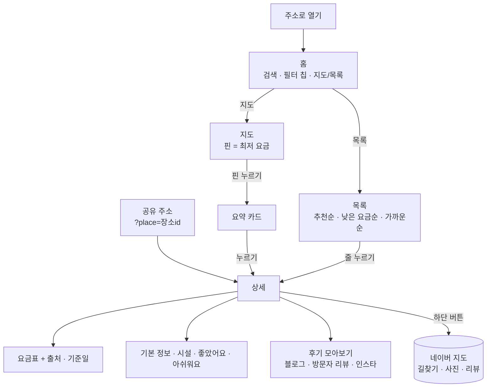
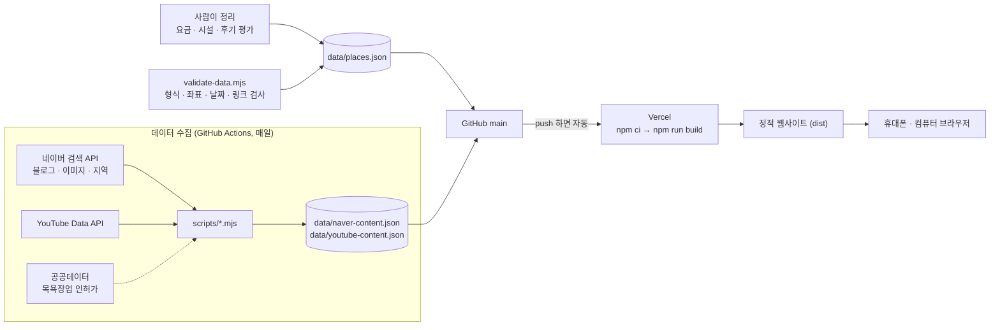

# 서울 찜질방 지도 기획서 v0.4

> 서울 찜질방의 **요금 · 시설 · 후기 · 사진**을 한 번에 비교하는 **모바일 웹** (토스 UI/UX 디자인 가이드 스타일)
>
> 작성일 2026-11-11 · 고침 2026-11-12 · 상태: 모바일 웹으로 Vercel에 배포 (`jjimjilbang-map/`)

| 버전 | 바뀐 점 |
| --- | --- |
| v0.1 | 네이버 지도 웹·앱 화면을 따른 정적 웹사이트로 기획하고 프로토타입을 만들었어요 |
| v0.2 | **앱인토스 WebView 미니앱으로 바꿨어요.** 앱인토스 개발자 가이드(WebView SDK 3.x, TDS, UX 라이팅, 출시 검수)에 맞춰 화면·기술·출시 계획을 다시 썼고, 데이터는 JSON으로 옮겼어요 |
| v0.3 | **유튜브·인스타 후기를 평가와 추천순에 넣었어요.** 후기마다 추천·장단점·아쉬움을 매기고, 추천한 영상·게시물로 바로 이동해요. 하단 버튼은 네이버 지도 길찾기로 바꿨어요 |
| v0.4 | **앱인토스 미니앱을 접고 모바일 웹으로 바꿨어요.** 처음 요청의 '토스 개발자 가이드'는 앱인토스가 아니라 토스 UI/UX 디자인 가이드를 뜻했어요. TDS 패키지는 앱인토스 밖(일반 도메인)에서 실행을 막아 Vercel에서 빈 화면이 떠서, 같은 원칙의 자체 컴포넌트로 바꿨어요. 앱인토스 SDK와 `.ait` 빌드는 뺐어요 |

---

## 1. 왜 만드나

찜질방을 고를 때 필요한 정보가 여기저기 흩어져 있어요.

| 문제 | 실제로 겪는 상황 |
| --- | --- |
| 정보가 흩어져 있음 | 요금은 블로그, 시설은 네이버 플레이스 사진, 분위기는 인스타에서 따로 찾아야 해요 |
| 요금이 출처마다 다름 | 이번 조사에서도 같은 곳의 성인 요금이 자료마다 13,000원~18,000원으로 달랐어요. 대부분 날짜 표시가 없어요 |
| 폐업한 곳이 아직 "추천"으로 돌아다님 | 드래곤힐스파(용산, 코로나 이후 영업 중단), 이태원랜드(철거), 실로암불가마사우나(2021 폐업)가 여전히 추천 글에 나와요 |
| 시설 비교가 어려움 | "노천탕 있고 여성 수면실 있는 24시간 찜질방"을 찾으려면 한 곳씩 다 열어봐야 해요 |

**기회:** 요금과 시설을 같은 기준으로 정리하고, 모든 요금에 출처와 날짜를 붙이고, 후기와 사진은 원문으로 바로 연결하는 지도 하나.

**왜 모바일 웹으로 내나**

- 설치 없이 링크 하나로 열려요. 찜질방은 "지금 근처"를 찾을 때가 많아서 앱 설치가 큰 장벽이에요.
- 카카오톡·문자로 주소를 보내면 받은 사람도 같은 찜질방 상세를 바로 열어요(`?place=장소id`). 찜질방은 친구·연인과 같이 가는 곳이라 공유가 중요해요.
- Vercel로 무료로 배포하고, main에 올리면 몇 분 안에 반영돼요. 앱 심사를 기다릴 필요가 없어요.
- 화면은 많은 사람이 이미 익숙한 토스 앱의 UI/UX 디자인 가이드를 따라, 처음 써도 헤매지 않게 해요.

## 2. 목표와 범위

**MVP 목표**

- 서울에서 영업 중인 찜질방 30곳 이상을 지도와 목록으로 보여주기 (지금 17곳, 후보 31곳 확인 중)
- 지도 핀에 최저 요금을 바로 보여줘서 가격을 한눈에 비교
- 요금 · 운영시간 · 시설 · 후기 요약 · 네이버/인스타 후기 링크 · 사진 바로가기를 상세 화면 하나에 모으기
- 모든 요금에 출처와 확인 날짜 표시
- **Vercel에 공개**하고 주소 하나로 공유할 수 있게 하기

**당장 하지 않을 것**

- 예약·결제, 회원가입·로그인, 자체 리뷰 작성: 운영 부담과 법적 책임이 커서 반응을 본 뒤 정해요. 찜은 로그인 없이 기기에 저장해요.
- 서울 밖 지역: 데이터 품질을 서울에서 먼저 검증해요.
- 데스크톱 전용 화면: 휴대폰 세로 화면을 기준으로 설계하고, 넓은 화면에서는 휴대폰 폭으로 가운데에 보여줘요.

## 3. 누가 쓰나

| 사용자 | 이런 순간에 | 필요한 것 | 대응 기능 |
| --- | --- | --- | --- |
| 데이트·친구 모임 (20대) | 주말에 분위기 좋은 곳을 찾을 때 | 사진, 인스타 감성, 루프탑·노천탕 | 사진 바로가기, 인스타 해시태그, 시설 칩, 링크 공유 |
| 막차 놓친 직장인·여행자 | 밤 12시, 근처에서 잘 곳이 필요할 때 | 24시간, 수면실, 야간 요금, 거리 | "영업 중"·"24시간" 칩, 가까운순, 야간 요금 행 |
| 아이 있는 가족 | 주말 나들이 | 키즈존, 주차, 소인 요금 | 키즈존·주차 칩, 소인 요금 행 |
| 외국인 관광객 | 숙소 대신 찜질방 체험 | 영문명, 위치, 요금 | 영문명은 데이터에 있어요. 영어 화면은 2단계에서 붙여요 |

## 4. 비슷한 서비스와 차이점

| 서비스 | 잘하는 것 | 아쉬운 점 |
| --- | --- | --- |
| 네이버 지도·플레이스 | 장소 정보, 방문자 리뷰, 사진이 가장 많음 | 찜질방끼리 요금·시설을 나란히 비교할 수 없음. 요금이 사진 속 안내판에만 있는 경우가 많음 |
| 카카오맵 | 위치·길찾기 | 찜질방 리뷰·요금 정보가 적음 |
| 블로그·인스타그램 | 생생한 후기와 사진 | 광고 글이 섞이고 날짜가 제각각, 폐업 여부를 알기 어려움 |
| 입장권 판매 플랫폼 (WAUG 등) | 할인 입장권 | 일부 대형점만 있음, 외국인 대상 |

**우리 서비스의 차이점:** 같은 기준(표준 시설 코드, 같은 형식의 요금표)으로 정리한 비교 + 출처·날짜 표기 + 네이버·인스타 후기로 바로 연결. 여기에 링크 하나로 설치 없이 열리고 바로 공유된다는 점이 더해져요.

## 5. 기능 목록과 우선순위

### P0 — MVP (구현됨)

- [x] 지도 핀에 최저 요금 표시 (어른 찜질 요금 기준, 예: `1.4만`)
- [x] 핀이 겹치면 추천순이 낮은 쪽을 작은 점으로 줄이고, 확대하면 다시 요금 핀으로 펼쳐요. 핀 아래 이름표가 보이는 확대 수준에서는 이름표 자리까지 계산해서 겹치지 않게 해요
- [x] 지도 ↔ 목록 전환. 지도에서 핀을 누르면 아래에 요약 카드가 뜨고, 카드를 누르면 상세로 가요
- [x] **영업 상태 표시** (한국 시간 기준): 영업 중 / 곧 영업 종료 / 영업 전 / 오늘 휴무 / 확인 필요. 정기 휴무(예: 매월 셋째 주 수요일)도 계산해요
- [x] 검색: 이름, 구, 역, 주소, 별칭
- [x] 필터 칩: 전체, 영업 중, 24시간, 1.5만원 이하, 찜한 곳, 여성전용, 시설 12종(불가마, 노천탕, 수영장, 수면실, 여성수면실, 황토방, 소금방, 얼음방, 숯가마, 세신, 키즈존, 주차)
- [x] 정렬(바텀시트): 추천순, 낮은 요금순, 가까운순(브라우저 위치 권한). **추천순은 유튜브·인스타·블로그 후기 평가를 합친 점수**예요 (8장)
- [x] **유튜브·인스타 추천:** 추천한 영상·게시물이 있는 곳은 목록·지도 카드·상세에 "유튜브 추천 7" 같은 배지가 붙고, "유튜브·인스타 추천" 칩으로 모아 볼 수 있어요
- [x] 상세: 배지 → 분류·이름·영업 상태 → 주의 안내 → 찜하기·사진·전화·공유 → 사진·시설 타일 → 요금표(출처·기준일) → **후기 평가** → 기본 정보(주소·전화 복사) → 시설 → 하단 "네이버 지도로 길찾기"
- [x] **후기 평가:** 추천·장단점·아쉬움 개수, 출처별 개수(유튜브·인스타그램·블로그·기사), 좋았어요·아쉬워요 요약, 유튜브·인스타그램·블로그·기사별 목록(평가와 한 줄 요약 표시, 누르면 원문 영상·게시물로 이동), 더 찾아보기(유튜브 검색·인스타 해시태그·네이버 블로그·방문자 리뷰)
- [x] **네이버 지도로 길찾기 (현재 위치 출발):** 하단 버튼을 누르면 휴대폰은 네이버 지도 앱이 현재 위치에서 그 찜질방까지 대중교통 길찾기를 바로 열어요. 앱이 없거나 컴퓨터면 브라우저 위치를 출발지로 넣은 네이버 지도 웹 길찾기가 열려요 (위치를 못 받으면 출발지만 비워 둬요)
- [x] 찜하기: 브라우저 저장소(localStorage)에 저장
- [x] 공유: 휴대폰 공유 시트(없으면 주소 복사). 공유 주소 `?place=장소id`로 들어오면 그 찜질방 상세가 바로 열려요
- [x] 상세 상단 바: 뒤로 가기·이름·공유. 브라우저 뒤로 가기로도 홈으로 돌아가고, 홈의 지도 위치와 목록 스크롤은 그대로예요
- [x] 외부 지도 키 없이 동작하는 간이 지도(서울 구 경계·한강·주요 지하철역). 네이버 지도는 정책을 확인한 뒤 설정 하나로 켤 수 있게 준비했어요
- [x] 넓은 화면(데스크톱)에서는 휴대폰 폭(600px)으로 가운데에 보여줘요

**v0.1에서 바뀐 것**

| v0.1 (네이버 지도 웹) | v0.2 이후 (토스 스타일) | 이유 |
| --- | --- | --- |
| 데스크톱 3단 화면 + 휴대폰 끌어올리는 시트 | 휴대폰 한 화면, 지도/목록 전환 | 주로 휴대폰으로 써요. 토스 디자인 가이드의 기본 패턴이 더 단순해요 |
| 상세 탭(홈·요금·시설·리뷰·사진) | 한 화면 스크롤 + 하단 고정 버튼 | 토스 화면 패턴이에요. 요금이 첫 화면 가까이 보여요 |
| 지역(구)·최대 요금 드롭다운 | "1.5만원 이하" 칩, 구는 검색으로 | 누르는 횟수를 줄였어요 |
| "현 지도에서 검색" | 뺐어요 (P2) | 장소가 17곳이라 아직 필요성이 낮아요 |
| 다크 모드 | 라이트 모드만 | 토스 디자인 가이드처럼 밝은 화면 하나로 다듬었어요 |
| 찜: 브라우저 저장소, 공유: `#장소id` 링크 | 찜: 브라우저 저장소, 공유: 공유 시트 + `?place=장소id` 주소 | 받은 사람이 바로 그 찜질방을 열어요 |
| 정보 수정 제보: GitHub 이슈 링크 | 뺐어요 (P1) | 일반 사용자에게 GitHub는 맞지 않아요. 제보 방법을 다시 설계해요 |

### P1 — 출시 전후

- [ ] 공개 준비: Vercel Deployment Protection 해제, 도메인 정하기, 휴대폰(iOS·Android)에서 길찾기 앱이 열리는지 확인
- [ ] 네이버 지도 쓰기: NCP Maps 키를 만들고 Vercel 도메인을 서비스 주소로 등록 (지금은 간이 지도)
- [ ] 네이버 검색 API로 블로그 후기·이미지 매일 자동 수집 (스크립트·Actions 준비 완료, 키만 넣으면 동작)
- [ ] YouTube Data API로 영상 매일 자동 수집 (스크립트·Actions 준비 완료, 키만 넣으면 동작). 새로 잡힌 영상은 사람이 보고 평가를 붙여 추천에 넣어요
- [ ] 인스타그램 추천 게시물 직접 큐레이션: 검색 엔진에 게시물이 잡히지 않아 지금은 개별 게시물 0건이에요 (위치 태그 페이지 2곳, 공식 계정 5곳은 연결함). 인스타그램 앱에서 링크를 복사해 넣어요
- [ ] **네이버 지역 검색 API로 좌표·전화번호 보정 (스크립트 준비 완료).** 지금 좌표는 모두 추정값이라 길찾기 도착 지점이 실제 입구와 다를 수 있어요
- [ ] 네이버 플레이스 ID 연결 → 사진·방문자 리뷰로 바로 이동
- [ ] 정보 수정 제보 (간단한 폼)
- [ ] 비교하기: 최대 3곳의 요금·시설을 나란히
- [ ] 운영시간 구조화를 17곳 전체로 확대 (지금은 24시간 12곳 + 3곳만 시각 정보가 있어요)
- [ ] 데이터를 번들 밖 JSON으로 분리할지 검토 (지금은 main에 올리면 Vercel이 자동으로 다시 배포해요)
- [ ] 사용 지표: 쿠키 없는 방문 통계(예: Vercel Web Analytics)로 개인정보 없이 기록

### P2 — 확장

- [ ] 로그인으로 찜 목록을 기기 사이에 맞추기
- [ ] 인스타그램 게시물 공식 임베드 큐레이션, 비즈니스 계정 연동
- [ ] 수도권(경기) 확장, "현 지도에서 검색", 100곳이 넘으면 핀 묶기(클러스터링)
- [ ] 사용자 리뷰·별점, 혼잡도, 할인 입장권 (수익 모델과 함께 정해요)

## 6. 화면 설계

**원칙: 토스 UI/UX 디자인 가이드를 따라, 처음 써도 헤매지 않게.**

- **한 화면에 하나의 목적:** 홈은 찾기(검색·필터·지도/목록), 상세는 한 곳 살펴보기예요.
- **크게, 넉넉하게:** 큰 굵은 제목, 넓은 여백, 회색 단계와 파랑 하나만 쓰는 색, 둥근 모서리.
- **다음 행동은 하나로:** 상세 아래에 "네이버 지도로 길찾기" 버튼 하나를 고정해요. 고르는 일은 바텀시트로, 결과는 토스트로 짧게 알려요.
- **문구:** 토스 UX 라이팅처럼 해요체로, 짧게, 필요 없는 말은 덜어내고, 다음에 할 일을 알려줘요. 예: "찜 목록에 담았어요", "위치 권한을 허용하면 가까운 찜질방을 보여드려요", "핀을 누르면 요금과 영업 상태를 볼 수 있어요", "아직 확인된 요금이 없어요. 방문 전에 전화로 확인해 주세요."
- **컴포넌트:** 화면 조각은 `src/ui`에 직접 만들었어요. 토스의 TDS 패키지는 앱인토스 미니앱 안에서만 실행되게 막혀 있어서(일반 도메인에서는 실행 시 오류) 쓰지 않아요. 토스 로고·상표도 쓰지 않아요.
- 상세 화면 맨 위에는 뒤로 가기·이름·공유가 있는 상단 바를 둬요.
- 라이트 모드, 휴대폰 세로 화면 기준이에요. 넓은 화면에서는 휴대폰 폭으로 가운데에 보여줘요. 아이폰 홈 표시줄 같은 안전 영역을 비워 둬요.
- 지도에서는 네이버 지도 앱에서 익숙한 것만 가져왔어요: 핀에 요금 표시, 오른쪽의 내 위치·확대·축소·전체 보기 버튼.

### 정보 구조



### 화면별 구성

| 화면 | 위에서 아래로 | 쓰는 컴포넌트 (`src/ui`) |
| --- | --- | --- |
| 홈 · 지도 (첫 화면) | 검색창 → 필터 칩 → 지도/목록 전환 → 지도(핀에 최저 요금, 오른쪽에 내 위치·확대·축소·전체 보기). 핀을 누르면 아래에 요약 카드, 누르기 전에는 "핀을 누르면 요금과 영업 상태를 볼 수 있어요" | `SearchField`, `Chip`, `SegmentedControl`, `ListRow`(요약 카드) |
| 홈 · 목록 | 제목 "서울 찜질방, 요금부터 비교해요" → 검색창 → 필터 칩(유튜브·인스타 추천 포함) → 지도/목록 전환 → "찜질방 N곳 · 추천순 ›"과 "유튜브·인스타·블로그 추천과 후기 평가를 합친 순서예요" → 찜질방 줄(사진 또는 시설 타일, 이름 + "유튜브 추천 N" 배지, 영업 상태·거리, 분류·구·역, 오른쪽에 최저 요금). 결과가 없으면 "필터 초기화" 버튼 | `Top`, `ListHeader`, `ListRow`, `Badge`, `BottomSheet.Select`(정렬), `Button` |
| 상세 | 상단 바(뒤로 가기·이름·공유) → 배지(유튜브 추천·24시간·여성전용·정보 확인 필요·어른 최저 요금) → 분류·구 / 이름 / 영업 상태·거리 → 주의 안내 → 찜하기·사진·전화·공유 → 사진·시설 타일 → 요금표(찜질·목욕·기타, 기준일, 포함·추가 요금, 출처) → 후기 평가(한 줄 평, 추천·장단점·아쉬움 개수, 출처별 개수, 좋았어요·아쉬워요, 유튜브·인스타그램·블로그·기사 목록 3개씩 + "N개 더 보기", 더 찾아보기) → 기본 정보(주소·역, 영업, 전화, 이용 대상, 복사 버튼) → 시설(찜질·목욕·휴식·편의) → 하단 고정 "네이버 지도로 길찾기"(좌표가 추정값이면 버튼 위에 안내) | `Top`, `Badge`, `Button`, `ListHeader`, `TableRow`, `ListRow`, `TextButton`, `FixedBottomCTA`(`topAccessory`), 토스트 |

상세는 사용자가 확인하는 순서(지금 열었나 → 얼마 → 평판 → 어디 → 시설)대로 놓았어요. 요금은 맨 위 배지(어른 최저 요금)와 요금표 두 곳에서 보여서 "가격이 다 보여야 한다"는 요구를 맞춰요. 후기 평가는 요금 바로 다음에 두어, 유튜브·인스타에서 어떻게 평가했는지 먼저 보고 원문 영상·게시물로 바로 넘어갈 수 있게 했어요. 실제 화면은 `npm run dev`로 볼 수 있어요.

## 7. 데이터 설계

장소 데이터는 `data/places.json` 한 파일에 있어요 (`{ "updatedAt": "...", "places": [...] }`). 빌드할 때 Vite가 JSON을 앱 번들에 넣어요. 데이터를 고쳐 main에 올리면 Vercel이 자동으로 다시 빌드·배포해요.

| 필드 | 형식 | 설명 |
| --- | --- | --- |
| `id` | `"sparex-dongmyo"` | 영문 소문자·하이픈. 공유 링크 `?place=id`에 쓰여요 |
| `name`, `nameEn`, `aliases` | 문자열 | 상호명, 영문명, 검색용 다른 이름 |
| `gu`, `address`, `station` | 문자열 | 자치구, 도로명주소, 가까운 역·출구 |
| `lat`, `lng`, `coordsApprox` | 숫자, 불리언 | WGS84 좌표. `coordsApprox: true`면 추정값 |
| `phone`, `hours`, `open24h` | | 전화, 운영시간 문장, 24시간 여부 |
| `schedule` | `{open, close, days?, note?}` | 24시간이 아닐 때 영업 시각. `days`는 0(일)~6(토). "영업 중" 계산에 써요 |
| `closed[]` | `{weekday, nth, label}` | 정기 휴무. 매월 셋째 주 수요일 = `{weekday: 3, nth: 3}` |
| `category` | 문자열 | 이름 옆 분류 (예: 워터파크·찜질방). 없으면 "찜질방" |
| `alert` | 문자열 | 상세에 노란 안내로 보여줄 주의사항 (예: 찜질방은 주말만 운영) |
| `gender` | `all` · `female` · `male` | 이용 대상 |
| `prices[]` | 아래 표 | 요금표 |
| `includes`, `extraFees[]` | | 요금에 포함된 것(찜질복·수건), 추가 요금 |
| `priceSource` | `{url, label, date}` | **요금 출처와 기준 날짜 (필수)** |
| `priceNote` | 문자열 | 출처마다 값이 다를 때 안내 |
| `facilities[]` | 시설 코드 | `data/facilities.json`에 정의된 25개 코드 |
| `facilityNotes` | 문자열 | 시설 특징 한두 문장 |
| `highlights[]`, `cons[]` | 문자열 | 후기에서 자주 나오는 장점·단점 (직접 요약) |
| `hashtags[]` | 문자열 | 인스타 해시태그 (`#` 없이) |
| `reviewLinks[]` | 아래 표 | 직접 고른 후기·추천 글과 유튜브 영상·인스타그램 게시물. 평가가 있으면 후기 평가와 추천순에 들어가요 |
| `instagram` | `{location: {url, posts, checkedAt}, account: {url, handle, followers}}` | 인스타그램 위치 태그 페이지(그 장소를 태그한 게시물 모음)와 업체 공식 계정. 위치 태그 게시물 수는 추천순의 화제성 점수에 들어가요 |
| `photos[]` | `{url, credit}` | 권리를 확인한 사진만 |
| `naverPlaceId`, `naverQuery` | | 네이버 플레이스 ID, 검색어 보정 |
| `verifiedAt`, `confidence` | | 정리한 날짜, 신뢰도(high/medium/low) |

**요금 한 줄 (`prices[]`)**

| 필드 | 값 | 예 |
| --- | --- | --- |
| `type` | `찜질`(찜질+목욕) · `목욕`(목욕·사우나만) · `기타`(숙박·연장 등) | `찜질` |
| `label` | 시간대·상품 이름 | `주간`, `야간`, `숯가마` |
| `who` | `대인` · `소인` · `초등` · `미취학` · `공통` | `대인` |
| `days` | `전체` · `평일` · `주말·공휴일` | `평일` |
| `time` | 시간 범위 | `05:00~20:00` |
| `price` | 원 단위 정수 | `14000` |
| `note` | 짧은 안내 | `찜질복 포함` |

지도 핀의 가격은 `type=찜질`, `who=대인/성인/공통`인 행 중 가장 싼 값이에요.

**후기·추천 링크 한 줄 (`reviewLinks[]`)**

| 필드 | 값 | 예 |
| --- | --- | --- |
| `title`, `url` | 글·영상 제목과 주소 | 유튜브는 `watch?v=영상ID`·`shorts/영상ID`, 인스타그램은 `/p/`·`/reel/` 주소만 |
| `source` | 매체·사이트 이름 | `유튜브`, `다음 뉴스`, `트립닷컴` |
| `date` | `YYYY` · `YYYY-MM` · `YYYY-MM-DD` | `2025-02` |
| `platform` | `youtube` · `instagram` · `web` (비우면 주소로 판단) | `youtube` |
| `kind` | `review`(그곳만 다룸) · `list`(여러 곳을 묶은 추천 모음) | `list` |
| `author` | 채널·계정·필자 | `bath.diary` |
| `verdict` | `recommend` 추천 · `mixed` 장단점 · `negative` 아쉬움 · `null` 판단 근거 없음 | `recommend` |
| `note` | 이 장소에 대해 한 말을 직접 한 줄로 요약 | `숯불에 고구마를 구워 먹는 재미를 호평` |
| `sponsored` | 협찬·광고 표시가 있으면 `true` | |

**시설 코드 (25종)**

| 그룹 | 코드 |
| --- | --- |
| 찜질 | `bulgama` 불가마·한증막, `hwangto` 황토방, `salt` 소금방, `charcoal` 숯가마, `ice` 얼음방, `jade` 보석·광물방, `pyeonbaek` 편백방 |
| 목욕 | `bath` 대중탕·사우나, `outdoor` 노천탕, `pool` 수영장·워터파크, `seshin` 세신 |
| 휴식 | `sleep` 수면실, `femaleSleep` 여성 수면실, `capsule` 개인실·캡슐, `rooftop` 루프탑, `movie` 영화·미디어룸, `comics` 만화·북카페 |
| 편의 | `food` 식당, `cafe` 카페, `pc` PC존, `gym` 헬스장, `massage` 마사지, `kids` 키즈존, `karaoke` 노래방, `parking` 주차 |

자동 수집한 네이버 블로그 후기·이미지는 `data/naver-content.json`에, 유튜브 영상(제목·채널·날짜·조회수)은 `data/youtube-content.json`에 따로 저장해요(사람이 고치는 파일과 기계가 만드는 파일을 분리). 자동 수집 결과는 평가 없이 "더 보기" 목록에만 붙고, 추천순에는 사람이 평가를 붙인 `reviewLinks`만 들어가요.

**기기에 저장하는 것:** 찜한 장소 id 목록 하나뿐이에요(브라우저 localStorage, 키 `jjim:favs`). 위치는 거리 계산에만 쓰고 저장하지 않아요.

## 8. 데이터 수집 전략과 정책 검토

가장 중요한 부분이에요. **크롤링 없이 공식 API와 링크만 쓰는 것**이 원칙이에요.

| 정보 | 어디서 | 어떻게 | 주기 |
| --- | --- | --- | --- |
| 찜질방 목록 | 서울 열린데이터광장 "목욕장업 인허가 정보" + 네이버 지역 검색 | 영업상태가 "영업"인 곳 중 찜질방을 골라 후보 목록 작성. 좌표가 중부원점TM(EPSG:2097)이라 WGS84로 변환 필요 | 월 1회 (폐업 확인 겸) |
| 좌표·주소·전화 | 네이버 지역 검색 API | `scripts/enrich-naver-local.mjs`. 한 번에 최대 5건, `mapx/mapy`는 WGS84 × 10⁷ | 새 장소 등록 시 |
| 요금·운영시간 | 업체 공식 SNS·안내판·전화, 공개 기사 | 사람이 정리하고 출처·날짜 기록 | 분기 1회 + 제보 시 |
| 시설 | 업체 안내, 후기 | 표준 시설 코드로 정리 | 분기 1회 |
| 네이버 블로그 후기 | 네이버 블로그 검색 API | 제목·짧은 요약·링크만 표시, 원문으로 이동. 하루 25,000회 무료 | 매일 (GitHub Actions) |
| 네이버 방문자 리뷰 | 공식 API 없음 | **크롤링하지 않고** 네이버 지도 링크로 연결 | - |
| 유튜브 영상 | YouTube Data API v3 검색 + 사람 검토 | 스크립트(`scripts/fetch-youtube.mjs`)가 장소 이름이 들어간 영상을 모으면, 사람이 보고 평가·한 줄 요약을 붙여 `reviewLinks`에 넣어요. 하루 무료 10,000단위 | 매일 (GitHub Actions), 평가는 수시 |
| 인스타그램 | 운영자가 고른 공개 게시물 주소 + 해시태그 페이지 링크 | 게시물 주소와 평가·한 줄 요약만 저장하고 원문으로 연결 | 수시 |
| 사진 | ① 직접 촬영·업주 제공 ② 네이버 이미지 검색 API ③ 외부 링크 | ①만 화면에 직접 게시. ②는 썸네일 + 원본 출처 링크 | 수시 |

**인스타그램 API의 현실:** 해시태그 검색(Graph API)은 비즈니스/크리에이터 계정 + 메타 앱 심사(Instagram Public Content Access)가 필요하고, 7일 동안 해시태그 30개까지만 조회할 수 있어요. 2026년 11월 조사에서도 웹 검색으로는 게시물·릴스가 한 건도 잡히지 않고 계정·장소 페이지만 나왔어요. 그래서 MVP는 ① 인스타그램 위치 태그 페이지(그 장소를 태그한 게시물 모음)와 공식 계정 연결, ② 운영자가 인스타그램 앱에서 "링크 복사"로 직접 고른 게시물, ③ 해시태그 링크로 시작해요. 위치 태그 게시물 수는 추천순의 화제성 점수에 넣어요.

### 후기 평가와 추천순

- **평가 기준:** 글·영상의 제목과 소개에 드러난 내용만으로 추천(추천·강추·BEST 목록에 포함 등) / 장단점(좋은 점과 아쉬운 점을 함께) / 아쉬움(실망·비추) / 판단 근거 없음(방문 기록만)으로 나눠요. 한 줄 요약은 원문을 옮기지 않고 직접 써요.
- **협찬:** 협찬·광고 표시가 있으면 추천순에 절반만 반영하고 목록에 "협찬"을 붙여요.
- **추천순 점수** = 링크마다 `출처 가중치 × 평가 점수 × 최신성 × (묶음 글 0.8) × (협찬 0.5)`를 더하고, 정보 신뢰도(높음 1, 보통 0.5, 낮음 0)와 화제성(네이버 블로그 글 수, 인스타그램 위치 태그 게시물 수 각각 최대 1점: 10개 0.25, 100개 0.5, 1,000개 0.75, 10,000개 이상 1)을 더해요.
  - 출처 가중치: 유튜브 1.2, 인스타그램 1, 블로그·기사 0.8
  - 평가 점수: 추천 1, 장단점 0.3, 아쉬움 -1, 판단 근거 없음 0.2
  - 최신성: 1년 안 1, 2년 안 0.8, 4년 안 0.5, 그 전 0.3, 날짜 모름 0.4
- 점수 계산은 `src/lib/data.ts`의 `reviewScore` 한 곳에 있어서 가중치를 바꾸기 쉬워요. 목록 위에 "유튜브·인스타·블로그 추천과 후기 평가를 합친 순서예요"라고 기준을 밝혀요.

**운영 원칙**

1. 네이버 플레이스·인스타그램을 크롤링하지 않아요. 약관 위반이고 법적 분쟁 소지가 있어요.
2. 후기 원문을 복사하지 않아요. 제목·짧은 요약·링크만 쓰고, 장단점 요약은 직접 써요.
3. 사진은 권리를 확인한 것만 직접 게시하고, 나머지는 출처로 연결해요.
4. 모든 요금에 출처와 날짜를 붙이고 "현장과 다를 수 있음"을 알려요. 12개월 넘은 요금은 검사기가 경고해요.
5. 현재 위치는 브라우저 위치 기능으로 받아 기기 안에서 거리 계산에만 쓰고 서버로 보내거나 저장하지 않아요. 서버에 위치를 저장하는 기능을 만들 때는 위치정보법상 신고 대상인지 먼저 확인해요.

### 웹 서비스 정책 검토

| 항목 | 확인한 내용 | 이 서비스의 대응 |
| --- | --- | --- |
| 디자인 시스템 | 토스의 TDS 패키지(`@toss/tds-mobile`)는 공개 라이선스가 없고, 앱인토스 미니앱이 아닌 곳(일반 도메인)에서 실행하면 "앱인토스 개발에만 사용할 수 있어요" 오류를 내고 멈춰요 (2026-11 Vercel 배포에서 확인) | TDS를 쓰지 않고 같은 원칙으로 자체 컴포넌트(`src/ui`)를 만들었어요. 토스 로고·상표는 쓰지 않아요 |
| 글꼴 | 토스 전용 글꼴은 쓸 수 없어요 | 공개 글꼴 Pretendard(SIL OFL)를 jsDelivr에서 불러오고, 실패하면 기기 기본 글꼴을 써요 |
| 네이버 지도 키 | NCP Maps 키는 등록한 서비스 주소에서만 동작해요 | 지금은 키가 필요 없는 간이 지도. 네이버 지도를 쓰려면 Vercel 도메인을 등록해요 |
| 다른 앱 열기 | 네이버 지도 앱 URL Scheme은 `appname`이 필수이고, 출발지를 비우면 현재 위치에서 출발해요 | 휴대폰에서 `nmap://route/public`을 열고, 앱이 없으면 네이버 지도 웹으로 가요 |
| 위치 정보 | 위치를 서버에 저장하면 위치정보법상 신고 대상인지 확인이 필요해요 | 브라우저에서 거리 계산에만 쓰고 저장·전송하지 않아요 |
| 공개 범위 | Vercel의 Deployment Protection(Vercel Authentication)이 켜져 있으면 로그인한 팀원만 볼 수 있어요 | 공개할 때 꺼요 (P1) |

## 9. 기술 설계



- **정적 웹사이트:** Vite + React + TypeScript로 만들고, Vercel이 `vercel.json`대로 빌드해 올려요. 서버가 없어서 운영비가 들지 않아요. 번들은 약 290KB(gzip 약 90KB)예요.
- **화면 컴포넌트:** `src/ui`에 토스 UI/UX 디자인 가이드 스타일의 컴포넌트(화면 제목, 목록 줄, 검색창, 칩, 세그먼트, 배지, 버튼, 하단 고정 버튼, 바텀시트, 토스트)를 직접 만들었어요. 외부 디자인 시스템 패키지에 기대지 않아 어느 도메인에서나 동작해요.
- **기기 기능은 한 파일에:** `src/lib/device.ts`가 위치, 저장소, 공유, 복사, 외부 링크, 길찾기를 브라우저 기능으로 처리해요.
- **화면 전환:** 화면은 홈과 상세 두 개예요. 상세는 주소 뒤 `#장소id`와 브라우저 기록으로 열고, 공유 주소 `?place=장소id`로 들어오면 상세가 바로 열려요. 상세를 여는 동안 홈을 지우지 않고 숨겨 두어 지도 위치와 스크롤이 그대로 남아요.
- **지도 어댑터:** 간이 지도(SVG, 기본값)와 네이버 지도가 같은 메서드(`setPlaces`, `update`, `focus`, `fit`, `toPixel` …)를 가져서, 앱 코드는 지도 종류를 몰라도 돼요. 간이 지도는 서울 25개 구 경계(통계청 2013)·한강·주요 지하철역을 그리고 끌기·두 손가락 확대를 지원해요.
- **네이버 지도 길찾기:** 휴대폰은 네이버 지도 앱 URL Scheme `nmap://route/public?dlat=위도&dlng=경도&dname=이름&appname=웹 주소`를 열어요. 출발지를 비우면 앱이 현재 위치에서 출발해요. 1.5초 안에 앱으로 넘어가지 않으면(앱 없음) 웹 길찾기로 가요. 컴퓨터는 새 탭을 먼저 열고(팝업 차단 방지) 브라우저 위치를 받아 네이버 지도 웹 길찾기 주소 `https://map.naver.com/p/directions/{출발}/{도착}/-/transit`를 열어요. 지점은 `x,y,이름,장소ID,종류`이고 x·y는 웹 메르카토르(EPSG:3857) 좌표예요. 출발지는 "내 위치", 장소 ID가 없으면 좌표 지점(`ADDRESS_POI`)으로 넣어요. 도착 좌표는 `places.json`의 좌표라서 좌표 보정이 길찾기 정확도를 좌우해요.
- **유튜브 수집:** `scripts/fetch-youtube.mjs`가 YouTube Data API v3로 장소마다 영상을 검색하고, 제목·설명에 장소 이름이 들어간 것만 남겨 `data/youtube-content.json`에 저장해요.
- **네이버 지도(선택):** `https://oapi.map.naver.com/openapi/v3/maps.js?ncpKeyId=키`로 불러와요. 2025년 NCP 신규 Maps 상품부터 파라미터 이름이 `ncpClientId`에서 `ncpKeyId`로 바뀌었어요. NCP 콘솔에 Vercel 도메인을 서비스 주소로 등록하고 `VITE_NAVER_MAP_KEY_ID`를 넣으면 켜져요.
- **키 관리:** 네이버 검색 API의 Client Secret과 YouTube API 키는 GitHub Actions 비밀값에만 넣고 앱 코드에는 절대 넣지 않아요.
- **확장할 때:** 찜을 기기 사이에 맞추려면 로그인과 서버리스 DB를 붙여요. 장소가 300곳을 넘으면 데이터를 구별로 나눠 필요할 때 불러와요.

### 파일 구조

```
jjimjilbang-map/
├── vercel.json              Vercel 빌드 설정
├── vite.config.ts
├── index.html
├── src/
│   ├── main.tsx             토스트 + 앱 상태
│   ├── AppContext.tsx       찜 · 내 위치 · 토스트
│   ├── App.tsx              홈 ↔ 상세 전환
│   ├── ui/                  토스 UI/UX 디자인 가이드 스타일 컴포넌트
│   ├── pages/HomePage.tsx   검색 · 필터 칩 · 지도/목록 · 정렬
│   ├── pages/PlacePage.tsx  상세
│   ├── components/          지도, 목록 줄, 아이콘
│   ├── lib/data.ts          데이터 정리 · 영업 상태 · 후기 평가 · 추천순 · 필터
│   ├── lib/device.ts        위치 · 공유 · 복사 · 저장 · 외부 링크 · 길찾기
│   ├── lib/map/             간이 지도(SVG) · 네이버 지도 어댑터
│   └── styles.css
├── data/
│   ├── places.json          찜질방 데이터 (사람이 관리)
│   ├── facilities.json      시설 코드 사전
│   ├── naver-content.json   네이버 후기 · 이미지 (자동 생성)
│   ├── youtube-content.json 유튜브 영상 (자동 생성)
│   ├── seoul-geo.json       서울 구 경계 + 한강
│   └── seoul-stations.json  간이 지도용 주요 지하철역 (근사 좌표)
├── scripts/                 검사 · 수집 스크립트
└── docs/기획서.md            이 문서
```

## 10. 현재 데이터 현황

2026년 11월에 공개 웹 자료(기사, 여행 가이드, 후기 사이트)를 서울 4개 권역으로 나눠 조사했고, 지금 영업 중이라는 근거가 있는 **17곳**을 넣었어요.

| 이름 | 구 | 어른 찜질 최저가 | 24시간 | 이용 | 요금 기준 시점 | 신뢰도 |
| --- | --- | --- | --- | --- | --- | --- |
| 클럽케이서울 | 강남구 | 17,000원 | O | 남녀 | 2025 | 높음 |
| 숲속한방랜드 | 서대문구 | 16,000원 | - | 남녀 | 2026-11 | 높음 |
| 더파크 스파랜드 | 영등포구 | 11,000원 | O | 남녀 | 2025-09 | 높음 |
| 씨랄라 | 영등포구 | 15,000원 | - | 남녀 | 2026-08 | 높음 |
| 강변스파랜드 | 광진구 | 15,000원 | O | 남녀 | 2025-11 | 높음 |
| 스파레이 | 서초구 | 22,000원 | O | 여성전용 | 2025-11 | 높음 |
| 스파렉스 굿모닝시티점 | 중구 | 14,000원 | O | 남녀 | 2026-11 | 보통 |
| 스파렉스 동묘점 | 종로구 | 18,000원 | O | 남녀 | 2025 | 보통 |
| 파크하비오 워터킹덤&스파 | 송파구 | 18,000원 | - | 남녀 | 2025 | 보통 |
| 베뉴지아쿠아24 | 강서구 | 11,000원 | O | 남녀 | 2026-06 | 보통 |
| 파라곤스파 | 양천구 | 11,000원 | O | 남녀 | 2023-07 | 보통 |
| 라성스파 | 성동구 | 12,000원 | O | 남녀 | 2025-02 | 보통 |
| 백제불한증막 인삼사우나 | 송파구 | 18,000원 | - | 남녀 | 2025-02 | 보통 |
| 우이령불가마주쉼사우나 | 강북구 | 확인 중 | - | 남녀 | - | 보통 |
| 뉴거평힐링24시찜질방 | 강남구 | 12,000원 | O | 남녀 | 2024-02 | 낮음 (확인 필요) |
| 해양불가마사우나 | 구로구 | 12,000원 | O | 남녀 | 2025 | 낮음 (확인 필요) |
| 봉일스파랜드 | 관악구 | 13,000원 | - | 남녀 | - | 낮음 (확인 필요) |

- 신뢰도 높음 6곳, 보통 8곳, 낮음 3곳이에요. 낮음은 화면에 "정보 확인 필요" 배지로 표시돼요.
- 좌표는 17곳 모두 주소로 추정한 값이에요. 네이버 지역 검색 API로 보정해야 해요.
- 요금 기준 시점이 12개월을 넘었거나 날짜가 없는 곳이 10곳이에요. 출시 전에 전화로 확인해야 해요.

**유튜브·인스타 후기 (2026-11 조사)**

- 유튜브 영상 44건을 14곳에 연결했고, 그중 25건이 추천이에요. 같은 추천 모음 영상이 여러 곳에 들어간 경우도 하나씩 셌어요.
- 추천 영상이 많은 곳: 숲속한방랜드 7건, 클럽케이서울 4건, 스파렉스 굿모닝시티점 3건, 강변스파랜드 2건, 스파레이 2건이에요.
- 유튜브 영상을 찾지 못한 곳: 우이령불가마주쉼사우나, 뉴거평힐링24시찜질방, 해양불가마사우나예요.
- 인스타그램 개별 게시물은 0건이에요. 2026-11-12에 다시 찾아봤지만 검색 결과에는 게시물·릴스 주소가 한 건도 없고 계정·장소 페이지만 나왔어요 (인스타그램은 로그인하지 않은 검색 엔진에 게시물을 거의 노출하지 않아요).
- 대신 인스타그램 **위치 태그 페이지** 2곳(클럽케이서울 516개 이상, 목동 파라곤스파 371개 이상)과 **공식 계정** 5곳(클럽케이서울, 씨랄라, 스파레이, 스파렉스 동묘점, 파크하비오 워터킹덤&스파)을 연결했어요. 위치 태그 페이지를 누르면 그 장소를 태그한 실제 게시물을 모두 볼 수 있어요.
- 강변스파랜드 공식 계정(게시물 1개)은 거의 쓰지 않는 계정이라 넣지 않았어요. 나머지 9곳은 위치 태그 페이지도 공식 계정도 찾지 못했어요.
- 영상 대부분은 검색 결과에 채널 이름과 날짜가 보이지 않았어요. 그래서 비워 두었고, 추천순에서는 "날짜 모름"으로 계산돼요. YouTube API 키를 넣으면 채널과 날짜가 채워져요.
- 조사에 쓸 수 있는 검색 횟수가 바닥나 일부 검색은 끝내지 못했어요. 특히 해양불가마사우나와 인스타그램 쪽 검색이 덜 됐어요.

**폐업·영업 중단이 확인돼 뺀 곳** (유명해서 아직 추천 글에 자주 나오는 곳들)

- 드래곤힐스파 (용산): 코로나19 이후 영업 중단, 재개 근거 없음
- 이태원랜드 (용산): 폐업 후 철거, 부지가 매물로 나옴(2022)
- 실로암불가마사우나 (중구 중림동, 서울역 근처): 2021년 말 폐업
- 스파1899 (인사동): 2026년 영문 가이드 한 곳에서 폐업으로 표기, 확인 필요

**운영 방식이 바뀐 곳**

- 씨랄라: 2026년 8월 24일부터 찜질방은 주말·공휴일만 운영
- 베뉴지아쿠아24: 옛 강서 그랜드아쿠아를 2025년 8월 리뉴얼

**다음에 확인할 후보 31곳** (근거가 부족해 이번에는 뺀 곳)

| 권역 | 후보 |
| --- | --- |
| 도심·서북 | 홍대24시불가마사우나(신촌로), 황금스파찜질방(황학동) |
| 동북 | 성수불막사우나, 서울숲황토참숯가마사우나, 해피데이스파, 목련사우나, 휘경인삼사우나, 천지연불한증막스파월드, 용마스파랜드, 솔잎여성불한증막, 한진불가마사우나, 24시삼선불가마사우나, 황후여성전용불한증막, 아쿠아산소사우나, 동궁해수사우나, 금강산보석불가마사우나, 월드해수사우나 |
| 동남 | 석정24시불한증막, 잠실수양불한증막, 더 스파 인 가든파이브, 송파여성소금한증막, 강남스파랜드, 천호사우나 |
| 서남 | 벽계수스파 가산, 유토피아스파, 스파존사우나, 동아24시여성불한증막, 백두산사우나, 보라매 스파, 솔로사우나레포 노량진점, 쑥고개 사우나 |

후보를 확인하면 MVP 목표(30곳)를 채울 수 있어요. 마포·은평·용산·동작·강동처럼 아직 한 곳도 없는 구는 공공데이터(목욕장업 인허가)로 먼저 후보를 뽑는 게 빨라요.

**이번 조사의 한계**

- 네이버 블로그와 플레이스는 조사 도구로 직접 열 수 없어서 기사, 여행 가이드, 후기 사이트 위주로 확인했어요. 네이버 검색 API 키를 넣으면 블로그 후기는 자동으로 채워져요.
- 인스타그램 해시태그는 상호명으로 만든 것이고 게시물 수는 확인하지 않았어요.
- "약 1년 전"처럼 상대 날짜만 있는 자료는 월을 추정했어요.

## 11. 일정

| 단계 | 기간 | 할 일 | 끝났다고 보는 기준 |
| --- | --- | --- | --- |
| 0. 기획·개발 | 완료 | 기획서, 지도·목록·상세, 후기 평가·추천순, 네이버 지도 길찾기, 토스 스타일 화면, Vercel 자동 배포 | main에 올리면 Vercel이 자동으로 배포 |
| 1. 공개 준비 | 1~2주 | 좌표 보정(길찾기 정확도), 전화로 요금 검증, 30곳까지 확장, 인스타 게시물 큐레이션, 네이버 지도 키 등록, 휴대폰 실기기 확인 | 30곳 모두 요금 확인일 3개월 이내 |
| 2. 공개 | 3주차 | Vercel 보호 해제, 지인 20명에게 주소 공유, 제보 받기 | 피드백 20건, 치명적 오류 0 |
| 3. 개선 | 4~8주 | 제보 폼, 비교하기, 공공데이터로 100곳 이상 확장 | 서울 영업 중 찜질방 대부분 수록 |
| 4. 확장 | 이후 | 로그인으로 찜 동기화, 영어 화면, 경기 지역 | |

## 12. 성공 지표

- **핵심 지표:** 상세에서 "네이버 지도로 길찾기"나 "전화"를 누른 비율 (실제 방문 의도)
- **후기 활용:** 후기 평가에서 유튜브·인스타 원문을 연 비율, "유튜브·인스타 추천" 칩 사용 비율
- **공유:** 상세에서 공유를 누른 비율, 공유 링크로 들어온 사용자 수
- **정보 최신성:** 요금 확인일이 90일 이내인 장소 비율 80% 이상
- **정확성:** "정보가 달라요" 제보를 7일 안에 반영
- **재방문:** 찜하기를 쓴 사용자 비율, 7일 안에 다시 들어온 비율

쿠키 없는 방문 통계(예: Vercel Web Analytics)로 시작해요. 개인을 알아볼 수 있는 정보는 모으지 않아요.

## 13. 위험과 대응

| 위험 | 영향 | 대응 |
| --- | --- | --- |
| 요금·영업 정보가 금방 낡음 | 신뢰가 떨어짐 | 확인일 표기, 12개월 지난 정보 자동 경고, 제보, 분기 검수 |
| 폐업한 곳이 계속 노출됨 | 헛걸음 | 공공데이터 영업상태와 월 1회 대조 |
| 사진·후기 저작권 | 분쟁 | 링크·직접 요약만 사용, 사진은 권리 확인 |
| 네이버 지도 키를 등록하지 않음 | 간이 지도만 보임 | 지도 없이도 목록·상세로 다 볼 수 있게 설계했어요. Vercel 도메인을 등록하면 네이버 지도로 바꿔요 |
| 디자인 시스템 라이선스 | 토스 TDS는 앱인토스 밖에서 실행되지 않음 | 같은 원칙의 자체 컴포넌트로 바꿨어요 (완료) |
| 데이터가 번들 안에 있음 | 요금을 고칠 때마다 다시 배포 | main에 올리면 Vercel이 몇 분 안에 자동으로 다시 배포해요 |
| 네이버·메타 API 정책 변경 | 기능 중단 | 링크만으로도 쓸 수 있게 설계 (지금도 키 없이 동작) |
| 좌표 추정 오차 | 핀 위치와 길찾기 도착 지점이 어긋남 | 지역 검색 API로 보정, 보정 전에는 길찾기 버튼 위와 상세 아래에 "추정 위치"라고 알리고 네이버 지도 장소 화면 링크를 같이 둬요 |
| SNS 평가가 한쪽으로 치우침 | 광고성 영상이나 묶음 추천이 순위를 끌어올림 | 협찬 0.5배, 묶음 글 0.8배, 오래된 영상은 낮게. 기준과 계산식을 공개하고, 원문으로 바로 가게 해요 |
| 추천 영상이 지워지거나 비공개로 바뀜 | 누르면 볼 수 없는 영상 | YouTube API 키를 넣으면 매일 다시 확인해서, 볼 수 없게 된 영상은 화면과 추천순에서 빼요 (`youtube-content.json`의 `unavailable`) |

## 14. 결정이 필요한 것

1. **지도:** 간이 지도로 갈지, 네이버 지도 키를 만들어 Vercel 도메인으로 등록할지
2. **공개 범위와 주소:** Vercel 보호를 풀고 누구나 보게 할지, 직접 산 도메인을 붙일지
3. **서비스 이름:** 가칭 "서울 찜질방 지도". 후보: 찜맵, 뜨끈지도, 서울 찜질 가이드
4. **범위:** 서울만 할지, 수도권(하남 스타필드 아쿠아필드 등)까지 넣을지
5. **사진 확보:** 직접 방문 촬영 / 업주 제휴 / 링크만
6. **수익 모델:** 광고·제휴 입장권을 할지. 하게 되면 광고 표시 정책이 필요해요
7. **사용자 리뷰:** 직접 받을지. 받으면 로그인과 신고·삭제 정책이 필요해요
8. **인스타그램 수집 방식:** 운영자가 직접 골라 넣을지, 메타 앱 심사를 받아 해시태그 검색 API를 쓸지
9. **추천순 가중치:** 유튜브·인스타·블로그 가중치와 협찬·묶음 글 감점을 지금 값으로 갈지
10. **길찾기 기본 수단:** 대중교통으로 둘지, 자동차·도보를 고르게 할지 (지금은 대중교통으로 열리고 네이버 지도에서 바꿀 수 있어요)

## 부록. 조사 출처

**토스 UI/UX 디자인 가이드**

- 토스 UX 라이팅(문구를 해요체로 통일, 필요 없는 말을 덜어내는 '잡초 뽑기'): [토스가 금융을 더 쉽게 만드는 또 하나의 방법, UX Writing](https://toss.im/tossfeed/article/uxwriter-interview)
- TDS 패키지(`@toss/tds-mobile`)는 앱인토스 미니앱 전용이라 일반 웹에서는 실행 시 막혀요 (2026-11 Vercel 배포에서 확인). 그래서 같은 원칙으로 컴포넌트를 직접 만들었어요
- 글꼴: [Pretendard](https://github.com/orioncactus/pretendard) (SIL Open Font License)

**지도·데이터**

- 네이버 지도 앱 길찾기 URL Scheme (`nmap://route/public`, 출발지를 비우면 현재 위치, `appname` 필수): [지도 앱 연동 URL Scheme](https://guide.ncloud-docs.com/docs/application-maps-url-scheme-vpc)
- YouTube Data API v3 (검색·영상 정보, 사용량 단위): [YouTube Data API 문서](https://developers.google.com/youtube/v3/docs)
- 네이버 지도 API v3 `ncpKeyId` 변경: [NAVER Maps API v3 튜토리얼](https://navermaps.github.io/maps.js.en/docs/tutorial-1-Getting-Client-ID.html), [NCP Maps 문제 해결](https://guide.ncloud-docs.com/docs/application-maps-troubleshoot)
- NCP Maps 무료 이용량·이용 한도: [NCP Maps 개요](https://guide.ncloud-docs.com/docs/maps-overview), [Maps 상품 페이지](https://www.gov-ncloud.com/product/applicationService/maps)
- 네이버 지역 검색 API (display 최대 5, WGS84 좌표, 하루 25,000회): [NAVER API Hub 지역 검색](https://api.ncloud-docs.com/docs/naver-api-hub-search-local)
- 인스타그램 해시태그 검색 제한: [Meta Hashtag Search 문서](https://developers.facebook.com/docs/instagram-platform/instagram-api-with-facebook-login/hashtag-search)
- 목욕장업 인허가 데이터: [서울 열린데이터광장](https://data.seoul.go.kr/dataList/OA-17929/S/1/datasetView.do)
- 마커 클러스터링: [navermaps/marker-tools.js 활용 예](https://velog.io/@sumi-0011/naver-marker-clustering-2)
- 찜질방별 요금·시설 출처는 `data/places.json`의 `priceSource`, `reviewLinks`에 장소마다 기록
